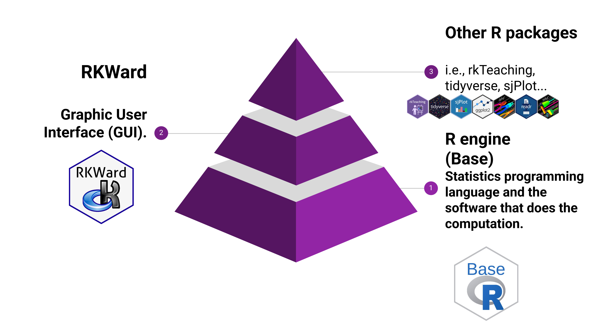
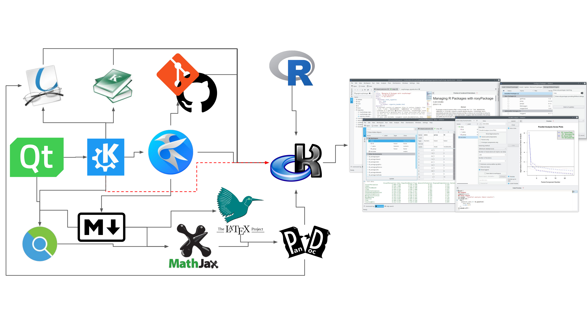
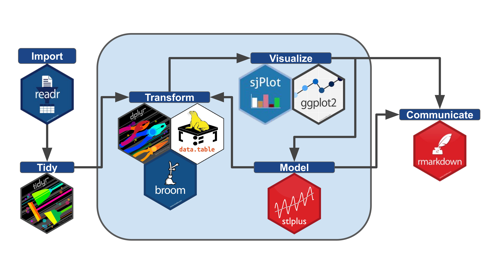
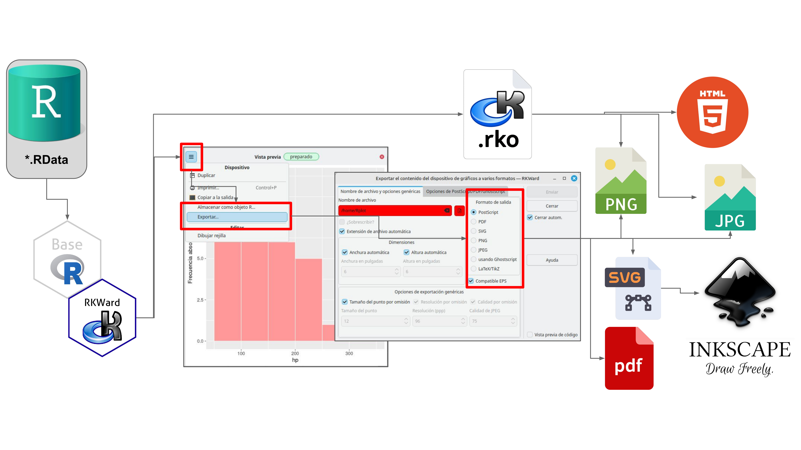
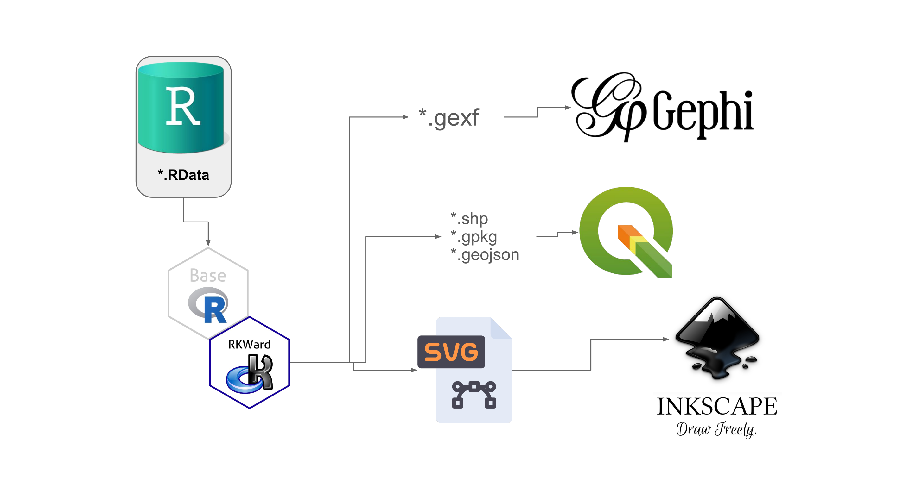
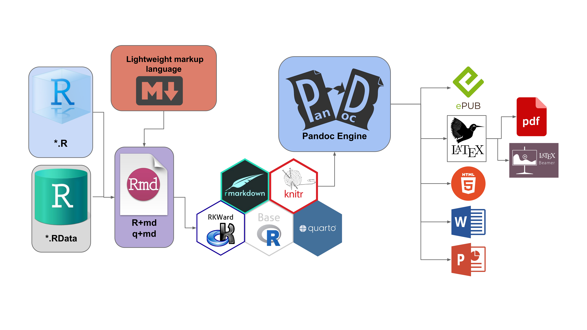

```{r setup, include = FALSE}
knitr::opts_chunk$set(
  collapse = TRUE,
  comment = "#>"
)
```

## 1. Core Philosophy and Architecture

### The Abstraction Pyramid
RKWard does not replace R; it empowers it. The abstraction pyramid shows how the ecosystem is built layer by layer to provide a seamless experience for both beginners and advanced users.

{width="75%"}


* **Level 1 (Base): The R Engine.** At its core, the standard R programming language handles all the heavy lifting, statistical computation, and memory management.
* **Level 2 (Middle): RKWard GUI.** Acting as the intelligent bridge, RKWard provides the Graphical User Interface (GUI), code editor, and workspace browser.
* **Level 3 (Top): GUI Plugins & R Packages.** Specialized packages like `tidyverse` and `sjPlot` are wrapped by `rk.universe` plugins, making their powerful functions accessible via clicks without needing to memorize syntax.

### The RKWard Core Architecture

RKWard utilizes a decoupled architecture rather than a monolithic one. It acts as a specialized IDE that bridges the R statistical engine (backend) with a graphical user interface frontend built entirely on **Qt and KDE Frameworks**. This separation ensures that intensive R computations do not block the user interface.

{width="75%"}

As the diagram shows, RKWard natively integrates enterprise-grade components: it uses **Kate** as its advanced text editor, links with **Git** for version control, and incorporates **MathJax and LaTeX** for real-time formula rendering. This creates a perfect "shell" that allows users to interact with the vast CRAN and R-Universe libraries without dealing with OS-level technical complexities.

---

## 2. The Data Science & Analysis Cycle

### The Modern Data Science Workflow
Our graphical menus are strictly designed around the industry-standard data science workflow (originally conceptualized by Grolemund & Wickham in *R for Data Science*).

{width="75%"}

*Note: Self-elaborated based on Grolemund, G., & Wickham, H. (2016). R for Data Science.*

With `rk.universe`, every step of this iterative cycle is covered by a dedicated GUI dialog:

* **Import:** Read datasets seamlessly with `readr` and `haven` wrappers.
* **Tidy & Transform:** Reshape and clean data effortlessly using `tidyr`, `dplyr`, and `data.table` plugins.
* **Visualize & Model:** Iterate through exploratory plots and fit statistical models natively.
* **Communicate:** Send your final results to RMarkdown or Quarto.

---

## 3. Export, Interoperability, and Publishing

### High-Fidelity Graphic Export

Academic publishing requires high-resolution, editable graphics. RKWard breaks "vendor lock-in" by allowing you to export your visualizations into multiple professional formats directly from the **on-screen graphics device** (or plot window).

{width="75%"}

* **Raster Formats:** High-resolution `PNG` and `JPG` for web and presentations.
* **Vector Formats:** `PDF` and `SVG` (Scalable Vector Graphics). Exporting to SVG allows researchers to open plots in **Inkscape** and edit them node-by-node to meet strict journal guidelines.

### Interoperability & Data Export

RKWard and the `rk.universe` ecosystem are designed to talk to the best scientific software in the world. By processing your `.RData`, our export tools allow you to send results exactly as other specialists need them:

{width="75%"}

* **Spatial Analysis (GIS):** Export spatial objects to `.shp`, `.gpkg`, or `.geojson` for native editing in **QGIS**.
* **Complex Network Analysis:** Export adjacency matrices and graphs to the `.gexf` format for advanced visual rendering in **Gephi**.

### Reproducible Research & Rendering Workflow

Data analysis doesn't end in the R console. Through add-ons like `rk.rmd` and `rk.quarto`, RKWard takes your data, merges it with Markdown text, and injects it into the **knitr** or **quarto** engines.

{width="75%"}

RKWard orchestrates the execution of **Pandoc** (the Swiss-army knife of document conversion) in the background. From a single interface, your R code seamlessly transforms into Beamer/PowerPoint presentations, PDF documents (via LaTeX), HTML5 pages, or ePUB books.
